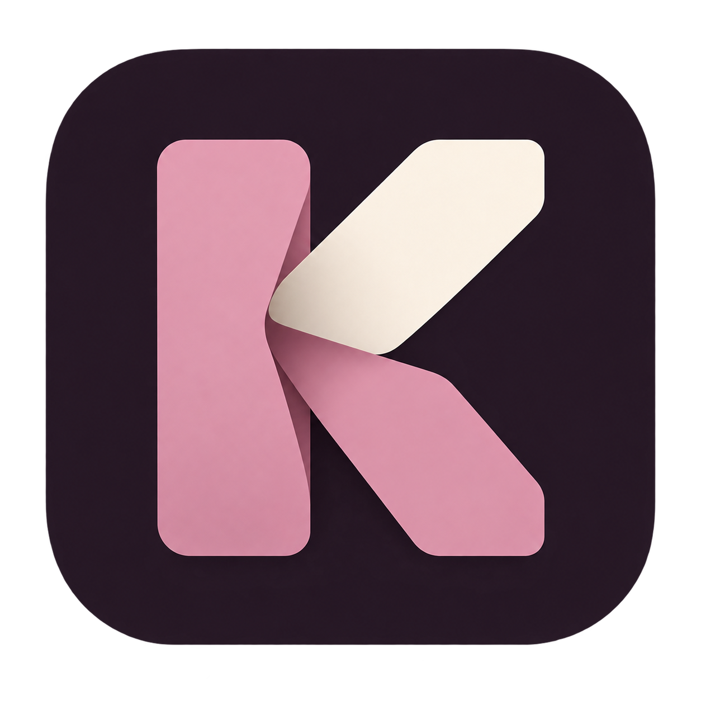
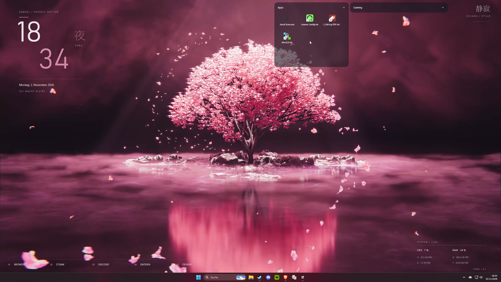
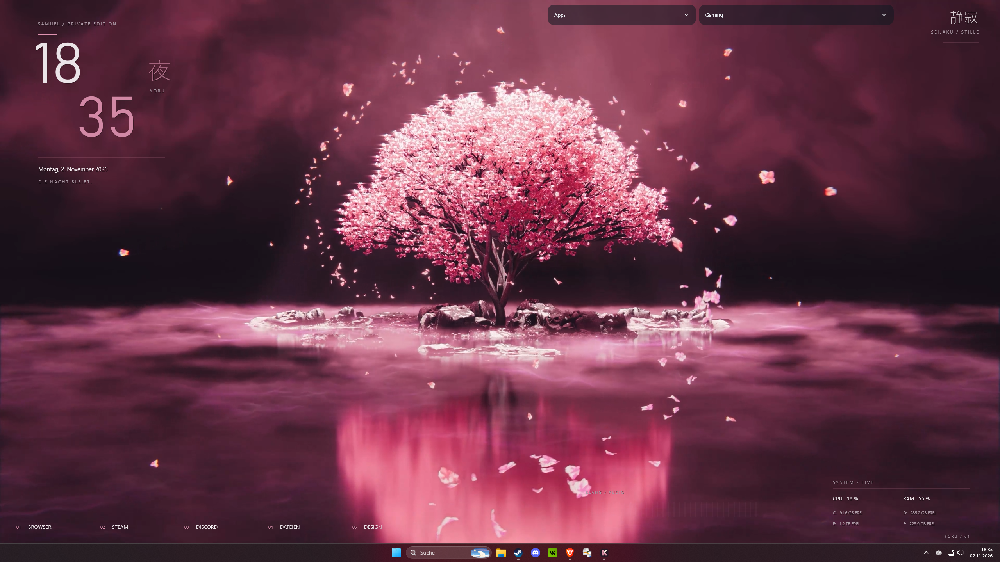
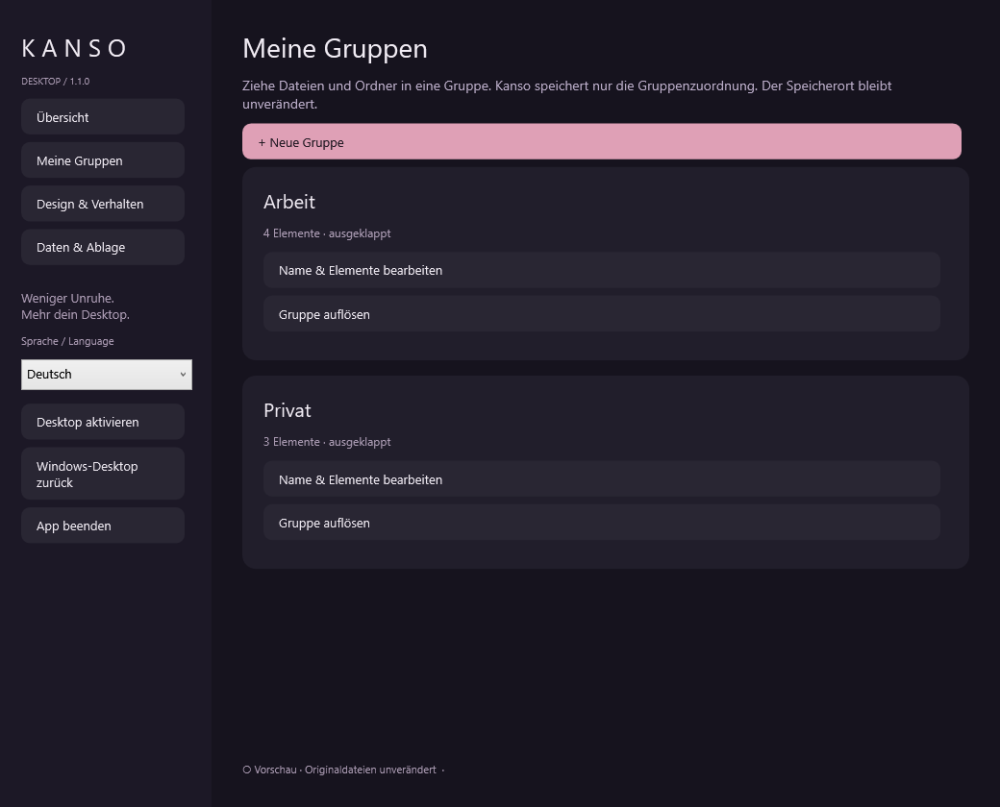

# Kanso Desktop



Dateien und Ordner in transparenten Gruppen organisieren. Für Windows x64.

[Herunterladen](https://github.com/SamyDeluxe01/kanso-desktop/releases/latest) · [Anleitung & Screenshots](#installieren) · [Fehler melden](https://github.com/SamyDeluxe01/kanso-desktop/issues)





*Originalaufnahmen vom Desktop des Entwicklers. Das Wallpaper und die zusätzlichen Desktop-Widgets gehören zum persönlichen Setup.*

Kanso ergänzt die vorhandene Windows-Desktopfläche um einklappbare Gruppen. Ziehe Dateien und Ordner hinein, öffne sie per Doppelklick und nutze ihr klassisches Windows-Kontextmenü. Die Originale bleiben an ihrem Speicherort.

## Installieren

1. Lade das Windows-ZIP von der [Release-Seite](https://github.com/SamyDeluxe01/kanso-desktop/releases/latest) herunter.
2. Entpacke die ZIP vollständig. Sie enthält einen Ordner **KansoDesktop** mit allen Programmdateien. Lege diesen Ordner an einem Ort ab, den du behalten möchtest.
3. Öffne im Ordner **KansoDesktop** die Datei **KansoDesktop.exe**. Die Windows-Laufzeit ist enthalten; eine separate .NET-Installation ist nicht nötig.
4. Kanso bereitet den Desktop-Modus vor. In der Übersicht kannst du ihn ein- und ausschalten.

Die App ist derzeit nicht digital signiert. Windows kann deshalb einen Hinweis zum unbekannten Herausgeber anzeigen. Prüfe vor dem Start die Downloadquelle und bei Bedarf die Prüfsumme aus dem Release.

## Benutzen

Unter **Meine Gruppen** legst du Gruppen an und änderst ihre Namen und Inhalte. Dateien und Ordner kannst du direkt hineinziehen. Herausziehen auf eine freie Desktopfläche oder Entfernen in den Einstellungen hebt die Zuordnung auf.



Der Pfeil klappt eine Gruppe ein. Am unteren Bildschirmrand öffnet sie nach oben. Unter **Design & Verhalten** stellst du Theme, Farben, Transparenz, Symbolgröße, Automatik und Animation ein.

**Mit Windows starten:** Auf der Übersicht findest du die beiden Schalter für Windows-Start und automatische Wiederherstellung des Desktop-Modus. Beide sind anfangs eingeschaltet. Ein ausdrücklich ausgeschalteter Desktop-Modus bleibt aus. Nach einem Umzug des Programmordners Kanso einmal am neuen Ort öffnen, damit der Autostartpfad aktualisiert wird.

**Aktualisieren:** Kanso beenden, Programmdateien ersetzen und den vorhandenen Ordner `user-state` behalten. Darin liegen deine Gruppenzuordnungen und ihre Sicherung. Persönliche Zuordnungen gehören nicht in öffentliche Fehlerberichte.

**Beenden:** Über das Kanso-Symbol neben der Windows-Uhr die Einstellungen öffnen und **App beenden** wählen. Die Windows-Symbole werden wieder freigegeben. Zum Entfernen der App vorher den Windows-Start ausschalten.

## Sprache

Deutsch, Englisch, Französisch, Spanisch, Italienisch, Portugiesisch und Japanisch sind in der Seitenleiste auswählbar. Die Sprache wird sofort angewendet und gespeichert. Eigene Gruppennamen und Dateinamen werden nicht übersetzt. Das native Windows-Dateimenü folgt weiterhin der Windows-Sprache.

## Was noch offen ist

Direktes Umbenennen in einer Gruppe und die Positionierung eines freigegebenen Symbols genau am Loslasspunkt sind noch nicht enthalten. Dateien aus anderen Ordnern bleiben Verweise. Vollständige Screenreader-Unterstützung sowie weitere Monitor-/Explorer- und Langzeitszenarien sind nicht vollständig geprüft. Der automatische Programmstart mit wiederhergestellten Gruppen ist bestätigt; ein kompletter Windows-Neustart wurde noch nicht nachgewiesen.

Kanso lädt für seine Gruppenfilterung ein natives Modul in den vorhandenen Explorer. Nach dem Beenden bleibt es inaktiv bis zum regulären Explorer-Neustart geladen.

## Unterstützen

Wenn dir Kanso im Alltag hilft, kannst du die Weiterentwicklung [über PayPal unterstützen](https://www.paypal.com/donate/?business=samuel.zirkelbach%40gmail.com&item_name=Kanso%20Desktop&currency_code=EUR). Kanso bleibt kostenlos und unter der MIT-Lizenz verfügbar.

## Aus dem Quellcode bauen

.NET 10 SDK und ein Windows-x64-C-Compiler werden benötigt. Das aktuelle Release-Projekt liegt unter `tests/KansoDesktop.NativeExperiments`. Der interne Projektname ist aus der Entwicklung erhalten geblieben. `src/KansoDesktop` allein enthält einen historischen Startpfad.

```powershell
./build.ps1 -Compiler C:\Tools\zig\zig.exe
```

Das Skript erstellt das selbstständige Paket unter `dist/KansoDesktop`. [Details zur Architektur und Prüfung](docs/DEVELOPMENT.md).

## Lizenz

[MIT](LICENSE) · Copyright 2026 Samy


